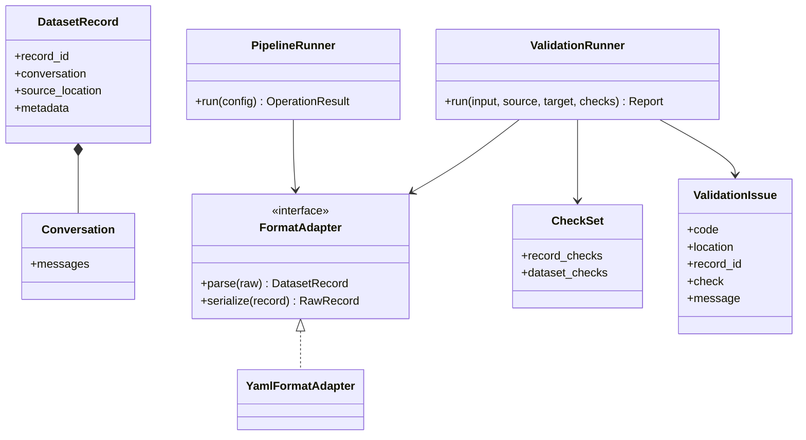

# datautil design

This document describes the current architecture and the planned validation extension. Planned commands and fields below are design proposals; they are not available in the CLI yet.

## Processing model

`DatasetRecord` is the unit of processing. It contains a stable record ID, one complete conversation, its source location, and metadata. A `Conversation` contains ordered messages. Format adapters parse source records into this model and serialize it into an output format. Operations consume records and produce datasets or reports; the pipeline connects operations without defining another record format.



`CheckSet`, `ValidationIssue.check`, and the proposed validation runner are planned interfaces. The current implementation has `validate()` in `operations.py` and uses the existing `Issue` type.

## Validation layers

| Layer | CLI | Responsibility | Status |
|---|---|---|---|
| Detection | `datautil detect INPUT` | Identify likely container and record format; detection does not establish validity | Available |
| Structural validation | `datautil validate INPUT --from FORMAT` | Parse records and check required fields, types, roles, nonempty messages, tool result references, and duplicate record IDs | Available |
| Quality checks | `datautil validate INPUT --from FORMAT --checks checks.yaml` | Apply configurable record and dataset constraints | Planned |
| Export compatibility | `datautil validate INPUT --from FORMAT --to FORMAT` | Check whether the target adapter can serialize each record without loss | Available |

No separate `--mode` switch is needed. `--checks` adds quality checks and `--to` adds target compatibility checks to the same validation pass.

`--format-config` defines where fields are located in a custom input or output format. It is distinct from `--checks`, which defines acceptable data values and relationships. `transform --rules` remains a data modification operation; validation must not modify records.

## Planned checks file

```yaml
version: 1
checks:
  unique_record_id: true
  allowed_roles: [system, user, assistant, tool]
  message_count:
    min: 2
    max: 50
  content_chars:
    max_per_message: 20000
  require_user_message: true
  tool_results: matched
```

Version 1 should accept only documented keys and valid value types. A bad checks file is a configuration error and stops before reading data. Checks should have stable codes so reports can be compared across runs. The built-in structural checks always run; the file adds constraints rather than disabling basic validation.

## Planned execution and report behavior

1. Load and validate the format profile and checks file before opening the input.
2. Read each JSONL record, reporting its line number. A malformed line becomes a validation issue; later lines are still checked. For a JSON array, report the array record index. An explicit partial-scan marker for unrecoverable array errors remains planned.
3. Parse the record, run structural checks, then quality checks. Run target serialization only for records that parsed successfully.
4. Run dataset-wide checks such as duplicate record IDs while reading. Keep the first location for each ID so the issue can point to both occurrences.
5. Aggregate counts by issue code and check name. `--max-errors N` already limits retained issue details without silently reporting success; per-check aggregation remains planned.

The existing `--report` remains a JSONL summary artifact. A planned issue entry has `code`, `location`, `record_id` when known, `check` when a configurable check produced it, and `message`. The summary includes `read_count`, `valid_count`, `issue_count`, `issues`, and `truncated`. An issue returns exit code 1; a malformed CLI argument returns 2; an I/O failure returns 3. JSON output to stdout remains the default for `validate`.

## Other operations

- `analyze` measures conversation length, text length, observed thinking, tool calls, and role distributions. Histogram intervals are chosen from the input data.
- `dedup scan` finds normalized exact matches, then uses MinHash LSH to propose near matches and exact Jaccard to confirm candidates. `dedup apply` consumes reviewed groups.
- `classify` calls an external model and writes per-record labels. `stats` consumes existing labels without model calls. A terminal percentage view for `stats --by domain` is planned; JSON output must remain available for scripts.
- `sample` and `split` use a seed. `split --groups` keeps grouped records in one partition.
- `run` executes configured steps in order and passes prior outputs by `@step_id`.

## Roadmap

The following phases are ordered by dependency, not by calendar date. Each phase should be reviewable and tested before starting the next. Ordinary feature commits do not require a version bump; a release can bundle several completed phases.

| Phase | Scope | Acceptance |
|---|---|---|
| 1. Reliable validation | Malformed JSONL recovery, duplicate IDs, accurate totals, and `--max-errors` are implemented; explicit partial-scan reporting for unrecoverable JSON arrays remains | A bad JSONL row does not hide later rows; duplicate locations and truncation are explicit; exit codes remain stable |
| 2. Configurable checks | Add `--checks` with a versioned YAML schema for roles, message counts, content length, user presence, and tool-result relationships | Invalid configurations fail before input processing; checks do not mutate data; `--checks` and `--to` work together |
| 3. Clearer statistics | Add an ASCII percentage view for `stats` while keeping JSON available through `--json`; keep count and denominator visible | Domain and usage totals match the JSON output; empty labels and mixed label fields have defined behavior |
| 4. Scale and reproducibility | Stream sample, split, classify, and dedup apply; keep dedup scan's text and shingles on disk; continue measuring the in-memory LSH index | Benchmarks record dataset size, peak memory, runtime, and output equivalence or documented selection differences |
| 5. Classification workflow | Record classifier settings and label-config fingerprints, make failures easy to retry, and document data sent to external endpoints | Retrying failures does not relabel successful records; `stats` remains completely offline |
| 6. Extension boundary | Stabilize the YAML format and check schemas; evaluate a Python adapter interface only when a real format cannot be expressed in YAML | Existing profiles remain readable; new adapters pass the same round-trip and loss checks as built-ins |
| 7. ClickHouse integration | Consider direct database reads only after exported `JSONEachRow` workflows and streaming behavior are stable | An optional dependency keeps ordinary installations lightweight; connection tests use a disposable database |
| 8. Release readiness | Decide the PyPI distribution name, publish supported Python and platform versions, and bundle changes into an intentional release | A clean wheel install passes the CLI smoke checks and the full test suite on Windows and Linux |

The next implementation target is the remaining JSON-array error reporting in phase 1, followed by phase 2. Tests should cover unrecoverable arrays, invalid checks configuration, record and dataset checks, combined `--checks` and `--to`, and proof that validation leaves input unchanged. The design document and usage guide should be updated whenever CLI behavior or report fields change.

### Large-file benchmark (phase 4, partial)

The first implementation pass streams records for `sample`, `split`, `classify`, `analyze`, `transform`, and `dedup apply`. Temporary SQLite files hold IDs, group membership, or selection decisions. `dedup scan` stores normalized text and shingles in SQLite while retaining the `datasketch` MinHash LSH index and match graph in memory. Temporary disk use therefore grows with input size, and dedup scanning is not constant-memory.

Measured on 5090x8 with Python 3.12 and `/usr/bin/time`, using 100,000 synthetic records in an 18 MB JSONL file (5,000 records for the candidate-heavy scan):

| Command | Old peak RSS | New peak RSS | Old time | New time | Result |
|---|---:|---:|---:|---:|---|
| `sample --count 1000` | 127 MiB | 28 MiB | 1.77 s | 2.63 s | Output byte-identical |
| `split --test-ratio 0.1` | 147 MiB | 31 MiB | 1.42 s | 4.51 s | 90,000 train / 10,000 test; deterministic assignment changed |
| `dedup apply` with 10,000 pairs | 140 MiB | 29 MiB | 2.28 s | 3.92 s | Dataset output byte-identical |
| `analyze --json` | 36 MiB | 28 MiB | 2.36 s | 2.70 s | Output byte-identical |
| `transform --rules` | 36 MiB | 28 MiB | 2.98 s | 3.24 s | Output byte-identical |
| `dedup scan` on 5,000 similar records | 240 MiB | 176 MiB | 25.08 s | 49.90 s | Group file byte-identical |

These are local measurements, not performance guarantees. The 5,000-record scan generated over three million LSH candidates; its cost is highly dependent on input similarity. Further work should benchmark less repetitive datasets, measure temporary disk use, and evaluate a disk-backed candidate index without changing the exact-match and Jaccard checks.

A separate split of the 100,000-record file with 10,000 two-record groups used 31 MiB peak RSS and 4.66 seconds. It produced 10,000 test records and no group crossed partitions. Replaying stdin through a temporary file preserves the original `-:line` source location, so generated record IDs remain deterministic.
